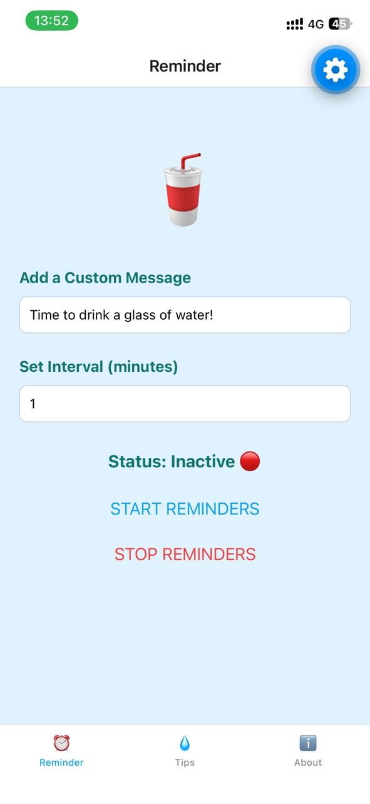

# Hydration Reminder App 💧


A React Native mobile application built with **Expo Router** to help users stay hydrated. This project demonstrates the implementation of hardware-level features such as OS-level permissions and scheduled **Local Notifications**.


---

## 📸 Output Screenshots

| Reminder Tab | Tips Tab | About Tab |
| :---: | :---: | :---: |
|  |  |  |

---

## ✨ Features

- **Local Notifications:** Schedule, trigger, and cancel repeating local device alerts without an internet connection using `expo-notifications`.
- **Tab Navigation:** Multi-tab layout (Reminder, Tips, About) built using `expo-router`.
- **Customizable Intervals:** Users can set their own time intervals (in minutes) for hydration reminders.
- **Custom Messages:** Users can personalize the notification alert message.
- **Foreground Handling:** Notifications are forced to display even when the app is open in the foreground.
- **Hardware Permissions:** Properly requests and handles OS-level notification permissions on app launch.

## 🛠️ Tech Stack

- **Framework:** React Native
- **Toolchain:** Expo
- **Navigation:** Expo Router (`app/_layout.tsx`)
- **APIs:** `expo-notifications`

## 🚀 How to Run Locally

1. **Clone the repository**
   ```bash
   git clone [https://github.com/pasinduvidushan258/HydrationReminder.git](https://github.com/pasinduvidushan258/HydrationReminder.git)
   cd HydrationReminder